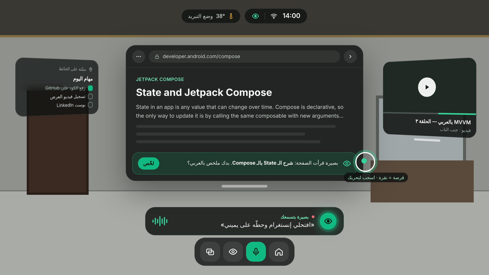

<div dir="rtl">

# بصيرة · Basira OS

**شاشتك صارت بحجم غرفتك.**

</div>



<div dir="rtl">

بصيرة نظام واقع مختلط بيشتغل كامل على موبايل أندرويد جوّا صندوق VR رخيص. الكاميرا الخلفية بتعرض غرفتك لعينين، ونوافذ الويب وواجهات النظام بتضل ثابتة بمكانها بالغرفة بفضل ARCore. بتتحكم بالنظر وبقرصة الإيد، وبمساعد صوتي عربي اسمه «بصيرة» بيقرأ الصفحة المفتوحة وبيلخّصها وبيتصرّف فيها.

**الحالة:** المرحلة 1 خلصت: passthrough لعينين بـ 60fps، مع تشويه العدسة وreprojection ومعايرة، وجرّبناه 10 دقايق بالنظارة بدون ما يسخن الموبايل. الجاية: أول نافذة ويب ثابتة بالغرفة.

</div>

**Basira OS** is a phone-based mixed reality system. An Android phone in a cheap VR viewer shows the room through its back camera in stereo, and web windows and system UI stay world-locked in the room with ARCore. You control it with head gaze + pinch (MediaPipe) and «بصيرة», an Arabic-first voice assistant that can read, summarise and act on the page in a window. Everything runs on the phone.

**Status:** phase 1 done: stereo passthrough at 60 fps with lens distortion, camera reprojection and calibration, tested for 10 minutes in a viewer without throttling. Next: the first world-locked web window.

---

## What makes it different

| | |
| --- | --- |
| **Understands the screen** | «لخّصلي هالصفحة», «عبّيلي الفورم»: the assistant reads the window, not just opens apps |
| **Arabic first** | RTL system UI, Levantine voice commands, on-device wake word «يا بصيرة», offline basic commands |
| **Heat-aware** | A `ThermalGovernor` drops hand-tracking rate, texture scale and live windows *before* the frame rate drops; every phase publishes measured fps and temperature |
| **Room memory** | Each room is a saved space: windows come back where you left them |

## Architecture

```
                 ┌──────────────┐        ┌──────────────────────────────┐
   Microphone ──▶│ :core:voice  │──text─▶│ :core:agent (LLM + tools)    │
                 └──────────────┘        └──────────────┬───────────────┘
                                                        │ commands
   Back camera ─┬──────────────▶ :core:tracking ──pose──┼──────────────┐
   (ARCore)     │                (ARCore / 3DoF)        ▼              │
                └─low-res frame─▶ :core:hands ──events─▶ :core:windows ◀──▶ :core:spaces (Room)
                                                        │ textures + poses
                                                        ▼
                                  :core:thermal ──QualityLevel──▶ :core:render ──▶ screen (L | R)
```

| Module | Responsibility |
| --- | --- |
| `:app` | Entry Activity, Hilt wiring, permissions, diagnostics / debug overlay |
| `:core:common` | `Pose`, `Ray`, `Vec3`, `QualityLevel`, dispatchers, logging |
| `:core:render` | GL thread, compositor, stereo split, lens distortion, reprojection |
| `:core:tracking` | ARCore session + 3DoF fallback → `Flow<HeadPose>` |
| `:core:windows` | Window manager, `VirtualDisplay` panels, gaze raycast, input injection |
| `:core:hands` | MediaPipe HandLandmarker, One Euro filter, pinch state machine |
| `:core:voice` | Wake word, STT, TTS behind interfaces |
| `:core:agent` | LLM client + tools (`open_app`, `summarize_page`, …) |
| `:core:spaces` | Room DB for spaces and window layouts |
| `:core:thermal` | `ThermalGovernor` → `StateFlow<QualityLevel>` |
| `:ui:system` | Compose system UI: theme, dock, home, assistant bar, status pills |

Rules: `:core:*` never depends on `:app`; `:core:render` knows nothing about ARCore or WebView (it gets textures + poses); every module exposes interfaces and binds implementations with Hilt.
Details: [docs/ARCHITECTURE.md](docs/ARCHITECTURE.md) · Design: [docs/DESIGN.md](docs/DESIGN.md) · Plan: [docs/PLAN.md](docs/PLAN.md)

## Roadmap

Each phase has a gate that must pass **on a real device** before the next one starts.

- [x] **0 · Setup**: multi-module project, Hilt, CI, diagnostics screen. *Gate: ARCore and MediaPipe run on the device*
- [x] **1 · Stereo passthrough**: camera → two eyes, barrel distortion, camera reprojection, calibration, thermal governor. *Gate: 10 min in the viewer at 60 fps without nausea* ([results](docs/phases/phase-1.md))
- [ ] **2 · World-locked window**: WebView panel anchored in the room, late reprojection, 3DoF fallback. *Gate: a page stays put while you turn and walk*
- [ ] **3 · Gaze + pinch**: raycast cursor, MediaPipe pinch, click / scroll / drag. *Gate: 9/10 clicks hit, no ghost clicks*
- [ ] **4 · Window manager + system UI**: dock, home, app catalog, plane snapping. *Gate: 4 windows with dock and home*
- [ ] **5 · Voice assistant**: push-to-talk, then «يا بصيرة»; open / close / arrange / search. *Gate: works in Levantine Arabic*
- [ ] **6 · Screen understanding**: summarise, ask, fill forms with confirmation. *Gate: any page summarised in < 5 s*
- [ ] **7 · Room memory**: saved spaces relative to a room origin. *Gate: windows return after restart*
- [ ] **8 · Performance + alpha**: full thermal budget, 30-minute run, release. *Gate: 30 min without throttling*

## Try it

1. Install the debug APK, grant the camera, and open **المعايرة** (calibration) with the phone in the viewer:
   pick your viewer (VR Shinecon / Cardboard v2), then with the **volume keys** fuse the two crosshairs (IPD),
   straighten the grid (k1, k2) and match a real door's size (**حجم العرض**). A tap or the viewer button selects the next value.
2. Press **ابدأ** for the stereo passthrough. Inside the viewer: **volume up** (or a tap) opens a web window
   in front of you, or brings it back in front of you; **volume down** toggles the developer overlay, and a
   **long press** on it toggles camera reprojection (A/B it while turning your head).
3. Every session writes a per-second CSV to `Android/data/com.basira.os/files/perf/`
   (fps, frame-time p95, missed frames, camera age, reprojection angle, thermal status, headroom, battery temperature).

How it works: [docs/phases/phase-1.md](docs/phases/phase-1.md). Measured on a Snapdragon 6 Gen 1 phone: 59.8 fps,
0.4% missed frames and no thermal throttling over 10 minutes in a VR Shinecon viewer.

## Build

Requirements: Android Studio (recent stable) or JDK 21 + Android SDK with platform 37.

```bash
git clone <this repo>
cd basira-os
./gradlew assembleDebug   # APK in app/build/outputs/apk/debug/
./gradlew test            # unit tests
```

Optional cloud keys go in the git-ignored `local.properties` and reach the code only through `BuildConfig`:

```properties
LLM_API_KEY=...
STT_API_KEY=...
```

No key is needed for phase 0. The diagnostics screen shows whether each key is configured, never its value.

## Device requirements

- Android 10 (API 29) or newer, OpenGL ES 3.0
- For 6DoF: a device on the [ARCore supported devices list](https://developers.google.com/ar/devices) with Google Play Services for AR. Other devices fall back to 3DoF.
- A phone VR viewer whose front leaves the back camera uncovered

## Similar work

[Orion Vision OS](https://github.com/MultiX0/orion-vision-os) explores the same idea (phone + viewer + passthrough + hands + voice). Basira OS is an independent implementation focused on Arabic, screen understanding, room memory and a measured thermal budget.

## License

Not chosen yet. Until one is added, all rights reserved. The bundled IBM Plex Sans Arabic font is under the SIL Open Font License ([ui/system/FONT_LICENSE-OFL.txt](ui/system/FONT_LICENSE-OFL.txt)).
